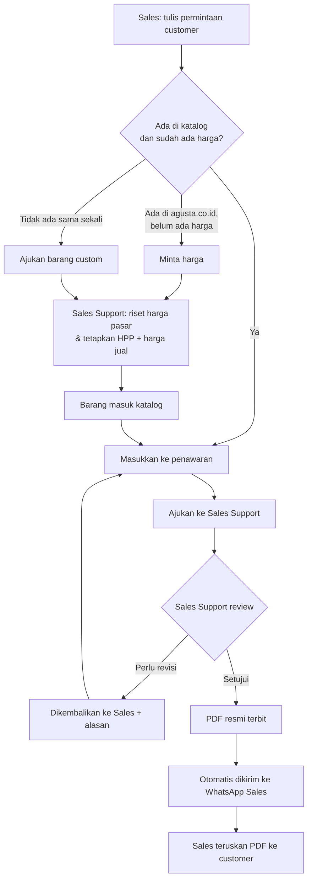

# Alur Kerja & Fitur — Agusta Quotation Portal

Portal internal Agusta untuk menyusun **surat penawaran harga**. Sales menyusun penawaran, Sales Support mereview dan menetapkan harga final, lalu PDF resmi terbit dan dikirim ke WhatsApp Sales.

- **Alamat:** https://agusta-quotation-portal.vercel.app
- **Status per 13 Nov 2026:** semua fitur di bawah sudah live. Database pusat (Supabase) dan WhatsApp Business **belum dihubungkan** (lihat [Status integrasi](#7-status-integrasi)).

---

## 1. Siapa memakai apa

| Peran | Bisa | Tidak bisa |
|---|---|---|
| **Sales** | Membuat penawaran, mencari produk, mengajukan barang custom / minta harga, merevisi penawaran yang dikembalikan | Melihat HPP, margin, maupun data supplier |
| **Sales Support** | Mereview & menyetujui/menolak penawaran, mengubah HPP & harga final, menghitung harga barang custom, riset harga pasar, sinkronisasi katalog, aturan diskon | Mengelola user |
| **Management** | Semua akses Sales Support + laporan margin + kelola user & hak akses | — |

HPP, margin, dan harga beli supplier **disembunyikan dari Sales di semua layar dan PDF**. Setelah database terhubung, data itu bahkan tidak terkirim ke browser Sales.

---

## 2. Alur utama: dari permintaan customer sampai PDF terkirim

### Langkah demi langkah

1. **Sales — Buat penawaran** (3 langkah)
   1. *Customer*: nama instansi, kontak, alamat, segmen (Korporasi / BUMN-Pemerintah / Pendidikan / Retail).
   2. *Produk*: ketik permintaan customer apa adanya, contoh: *"20 kursi ergonomis di bawah 2,5 juta dan 5 komputer core i7 16gb TKDN"*. Sistem menyarankan produk + jumlahnya (lihat [Smart search](#31-smart-search)). Diskon disarankan otomatis sesuai segmen & jumlah.
   3. *Tinjau & ajukan*: pratinjau surat penawaran, catatan untuk Sales Support, lalu **Ajukan ke Sales Support**.
2. **Sales Support — Review**: buka antrean review, ubah harga jual / diskon / HPP per item. Sistem memberi peringatan bila margin di bawah batas aman.
   - **Setujui & terbitkan PDF** → PDF resmi (kop Agusta, foto produk, spesifikasi, harga, PPN 11%, tanda tangan Sales + Direktur) terbit dan **otomatis dikirim ke WhatsApp Sales**.
   - **Kembalikan** → wajib menulis alasan; Sales menerima notifikasi "perlu revisi", merevisi, dan mengajukan ulang.
3. **Sales** menerima PDF di WhatsApp dan meneruskannya ke customer.

Setiap penawaran punya **riwayat** (diajukan, direvisi, disetujui, dikirim) beserta siapa dan kapan.

---

## 3. Fitur

### 3.1 Smart search
Kolom pencarian membaca permintaan dalam bahasa sehari-hari:
- **Jumlah**: "20 unit", "x20", "selusin".
- **Budget**: "di bawah 3 juta", "maks Rp 2.500.000", "sekitar 9 jt", "budget total 50 juta" (dibagi per unit).
- **Spesifikasi**: Core i3/i5/i7, RAM, SSD, TKDN, e-Katalog LKPP, kapasitas meja ("untuk 10 orang").
- **Beberapa barang sekaligus** (dipisah "dan", koma, atau baris baru).
- **Typo & sinonim** ("lenvo" → Lenovo, "sandaran kepala" → headrest).

Hasilnya panel **"Saran untuk permintaan ini"**: satu saran per barang, alasan kecocokan, peringatan (di atas budget, stok kurang), alternatif, dan tombol **Tambah semua saran**.

### 3.2 Katalog selaras dengan agusta.co.id
- Saat Sales mencari, portal juga mencari di **agusta.co.id** (bagian *Dari agusta.co.id*).
- Produk website yang belum ada harganya di portal → tombol **Minta harga** (nama, foto, spesifikasi, dan link website terisi otomatis).
- Sales Support / Management: **Katalog → Sinkronkan dari agusta.co.id** menarik seluruh katalog website (±1.964 produk). Produk baru diberi tanda **Perlu harga** dan tidak bisa dipakai di penawaran sebelum harganya diisi. Harga, HPP, stok, dan nama yang sudah ada tidak ditimpa.
- Catatan: website Agusta tidak mencantumkan harga, dan server fotonya lambat (foto bisa muncul telat).

### 3.3 Barang custom & riset harga pasar ("Google crawling")
Untuk barang yang tidak ada di katalog:
1. **Sales** mengajukan barang custom (nama, kategori, jumlah, target harga, spesifikasi, referensi). Kalau ternyata barang serupa sudah ada di katalog, sistem menyarankannya lebih dulu.
2. **Sales Support** membuka request → panel **Riset harga pasar** → **Cari harga**: barang serupa dari toko online (Tokopedia, Shopee, Bhinneka, Blibli, dll. via Google Shopping) dengan **foto, harga, nama toko, rating, link**, plus harga **termurah / median / termahal**. Harga tidak wajar (aksesori, grosir) disaring.
3. **Pakai sebagai acuan** → toko tercatat sebagai supplier, HPP terisi, harga jual disarankan pada margin 20%.
4. **Setujui harga** → barang masuk katalog (dengan foto) dan Sales langsung bisa memakainya di penawaran.

Bisa juga diisi manual (tombol buka Google Shopping/Tokopedia/Shopee/Bhinneka/Blibli di tab baru).

### 3.4 PDF penawaran
Surat resmi A4 ber-kop Agusta: nomor `QTN-YYMMDD-NNNN`, data customer, tabel item dengan **foto produk** dan spesifikasi, diskon, subtotal, PPN 11%, total, masa berlaku 14 hari, tanda tangan elektronik Sales & Direktur. HPP dan margin tidak pernah dicetak.

### 3.5 Notifikasi
| Kejadian | Penerima | Di portal (lonceng) | WhatsApp |
|---|---|---|---|
| Penawaran baru / direvisi | Sales Support & Management | ✅ | ✅* |
| Penawaran disetujui | Sales pengaju | ✅ | ✅ PDF terlampir |
| Penawaran perlu revisi | Sales pengaju | ✅ | ✅* |
| Request barang custom baru | Sales Support & Management | ✅ | ✅* |
| Harga custom dihitung / disetujui / ditolak | Sales pengaju | ✅ | ✅* |

Lonceng menampilkan jumlah belum dibaca, klik langsung membuka penawaran terkait, dan bisa memunculkan notifikasi desktop browser. \*WhatsApp aktif setelah akun WhatsApp Business terhubung.

### 3.6 Lainnya
- **Aturan diskon**: atur saran & batas diskon per segmen customer dan jumlah, plus batas margin minimum; ada simulator.
- **Laporan margin** (Management).
- **User & hak akses** (Management): tambah/ubah user, role, nomor WhatsApp, reset kata sandi, nonaktifkan akun.
- **Dashboard** per role: pekerjaan yang perlu ditindaklanjuti lebih dulu.
- **Tidak diindeks Google**: portal internal disembunyikan dari hasil pencarian (noindex).
- Tampilan mobile (menu jadi drawer, lonceng di header).

---

## 4. Contoh pesan WhatsApp ke Sales

> Halo Ismi Putri, penawaran **QTN-261109-0088** untuk **PT Maju Bersama** telah DISETUJUI oleh Sales Support.
> Total penawaran: **Rp 233.100.000** (termasuk PPN 11%).
> Dokumen PDF resmi bertanda tangan terlampir dan siap diteruskan ke customer.
> 📎 Penawaran_QTN-261109-0088.pdf

---

## 5. Akun demo (mode demo saja)

Kata sandi semua akun: `agusta123`

| Role | Email |
|---|---|
| Sales | ismi.putri@agusta.co.id |
| Sales Support | rizki.saputra@agusta.co.id |
| Management | dewi.lestari@agusta.co.id |

Di mode demo, data tersimpan di browser masing-masing (tidak dibagi antar komputer). Tombol **Reset data demo** di sidebar mengembalikan data awal.

---

## 6. Teknologi singkat

| Bagian | Teknologi |
|---|---|
| Tampilan | React 19 + Vite + Tailwind, di-hosting di Vercel |
| Database & login | Supabase (Postgres + Auth + Storage), dengan aturan akses per role di database |
| Fungsi server | Vercel Functions di folder `api/` (WhatsApp, user, agusta.co.id, riset harga) |
| WhatsApp | Meta WhatsApp Business Cloud API |
| Riset harga pasar | Google Shopping via Serper.dev |
| Katalog website | Data JSON dari agusta.co.id |

Panduan setup teknis lengkap: [docs/backend-setup.md](docs/backend-setup.md).

---

## 7. Status integrasi

| Integrasi | Status | Yang dibutuhkan |
|---|---|---|
| Riset harga pasar (Serper.dev) | ✅ **Aktif** | Kuota gratis 2.500 kredit (±1.250 pencarian). Paket Starter $50 = 50.000 kredit, berlaku 6 bulan |
| Katalog agusta.co.id | ✅ **Aktif** | — |
| Database pusat & login sungguhan (Supabase) | ⏳ Belum | Buat project Supabase, jalankan 4 file migrasi di `supabase/migrations/`, isi env di Vercel |
| WhatsApp Business (Meta) | ⏳ Simulasi | Akun Meta Business terverifikasi, nomor pengirim, 2 template pesan disetujui Meta, token |
| Sinkron katalog otomatis harian | ⏳ Belum dibuat | Bisa ditambahkan setelah Supabase aktif (saat ini lewat tombol) |

Selama Supabase belum terhubung, portal berjalan dalam **mode demo**: semua fitur bisa dicoba, tetapi data tidak tersimpan terpusat dan WhatsApp hanya tercatat sebagai simulasi.
